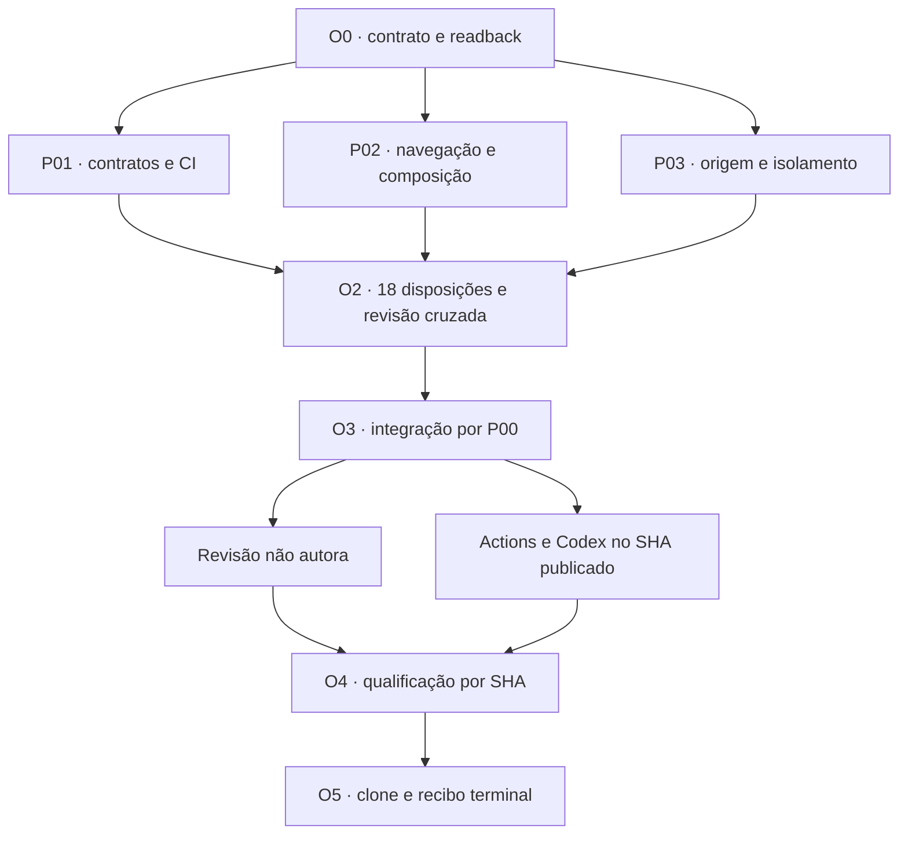

# DAG, ownership e gates

## Ordem executada

P01, P02 e P03 foram executores nativos reais em paralelo após O0. Cada um escreveu
somente sua área de análise. O ciclo P01→P02, P02→P03 e P03→P01 examinou autoria
distinta. P00 foi o único writer de produto, testes integrados e composição.

## Gates e evidências

| Gate | Owner | Prova / condição |
|---|---|---|
| G0_SOURCE | P00 | ZIP com 11 entradas autenticadas; main, PRs, 19 comentários anteriores, refs, ancestry e políticas revalidados em [O0](evidence/O0-CONTRACT.json). |
| G1_PRODUCT | P00 | Baseline `8f8fe01`, fontes somente leitura, valores literais, produtor externo, 0.2.0 preservado e ARC-09 isolado. |
| G2_DECISIONS | P00 + três revisores | 18/18, 84 requisitos + 240 itens; [O2](evidence/O2-DECISIONS.json) e três revisões não autoras. |
| G3_EXECUTE | P00 | [Quatro tarefas](tasks.md), preimages da baseline, RED real, patch e regressões GREEN; sem modificação dos ledgers protegidos. |
| G4_QA | P01/P02/P03 + Actions/Codex | Reviews dos bytes atuais, Ubuntu/Windows normal/-O, build/install, Chromium e resultado Codex no SHA exato. O recibo terminal da PR contém os IDs de jobs e o SHA efetivamente qualificado. |
| G5_PORTABILITY | P00 | Clone limpo por rede, commit/tree íntegros, refs históricas e #40 recuperáveis; recibo terminal registra os comandos/resultados. Sem exclusão. |

## Integração

Uma branch: `fix/atlas-convergence18-20261108`, criada de
`8f8fe01c3041361aa2607194d66af6a640d834ad`. Uma PR Draft reúne os reparos relacionados
e as disposições. A PR #40 permanece separada, em
`7ac3e76d12f6d2e59d235458dc122d85850cf499`. Nenhuma depende de merge da outra.

Não houve cherry-pick de infraestrutura O1/OS/K ou de propostas normativas. Os
testes antigos, preservados por SHA, não passam a qualificar a candidata atual.
Alteração material após revisão exige nova conferência dos arquivos afetados e
nova CI no HEAD resultante. Um commit documental também recebe seu próprio CI.

## Spec Kit

O repositório contém Spec Kit 1.2.3, suas skills e os helpers Python. O helper real
`check_prerequisites.py --json --require-spec --require-tasks --include-tasks`
foi executado para as Features 001, 004 e 007, sem persistir seletor global.
As skills analyze/converge/implement orientaram a análise e o reparo pontual.
CLI `specify`: **NOT_RUN — não instalado**, sem instalação nesta missão.

O auditor recusou o append de tarefas à baseline protegida da Feature 001. Os
bytes originais foram restaurados, o FAIL foi preservado como evidência, e as
novas tarefas foram registradas no ledger próprio desta missão. Não houve repin
de histórico nem alteração do auditor para permitir o patch.

## Gates humanos separados

ARC-09/0.2.1, ampliação do aceite privado OLD/NEW/zoom, retomada de aquisição O1
produtiva/testemunho L0 e merge/deploy/release/exclusão exigem seus atos próprios.
São decisões distintas. Sua pendência não autoriza inventar trabalho local nem
interrompe os reparos remotos independentes; tampouco recebe PASS de produto.
