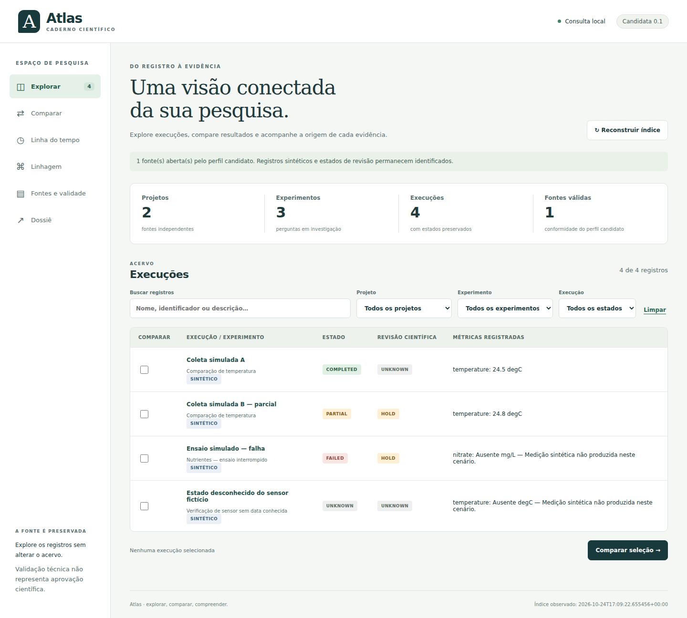
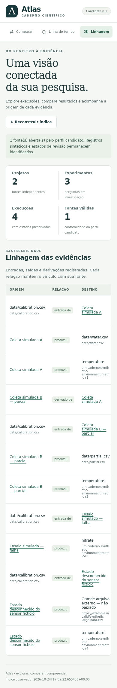

# Evidência da interface instalada

Estas capturas mostram o wheel da candidata em Chromium real, com o corpus ambiental
público e explicitamente sintético. Nenhum dado do produtor privado foi incorporado.
Capturas são evidências visuais; os testes e os registros de build delimitam seu alcance.

A instalação foi feita em ambiente virtual novo, sem R4; SDK e interface carregados
fora da árvore de fontes. Fontes foram conferidas por bytes antes/depois da leitura,
dossiê e reconstrução. A revisão local está em [A4](../reviews/A4-implementation-review.md).
CI e Codex do SHA publicado são gates adicionais; resultados pendentes permanecem pendentes.
